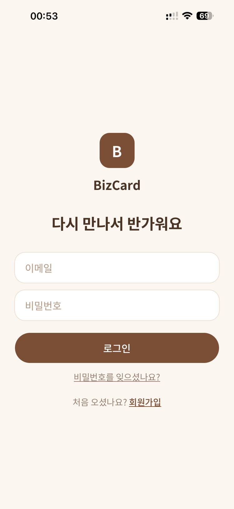
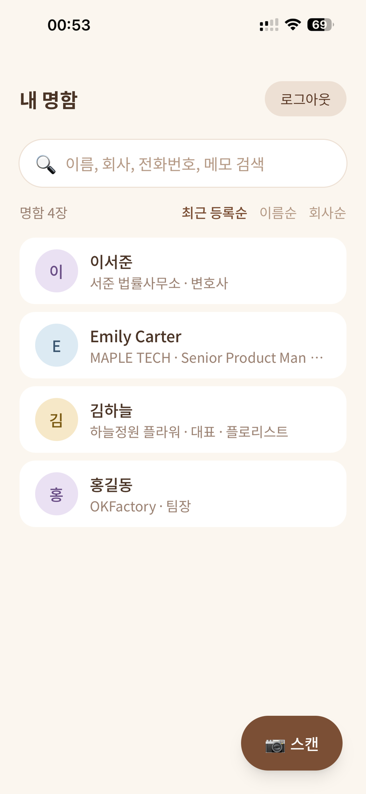
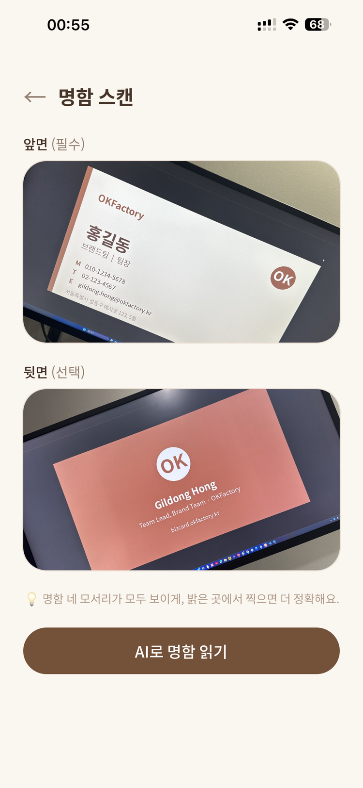
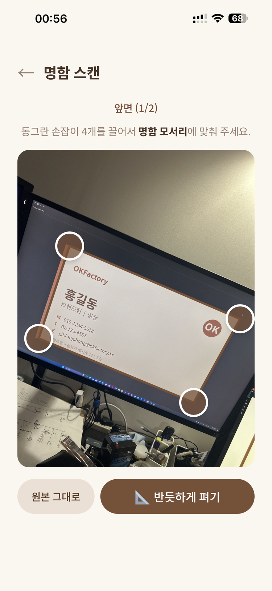
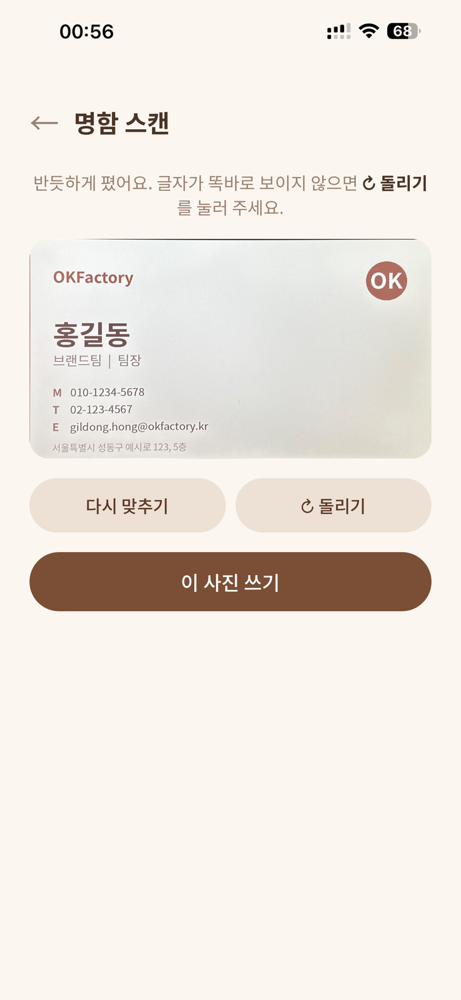
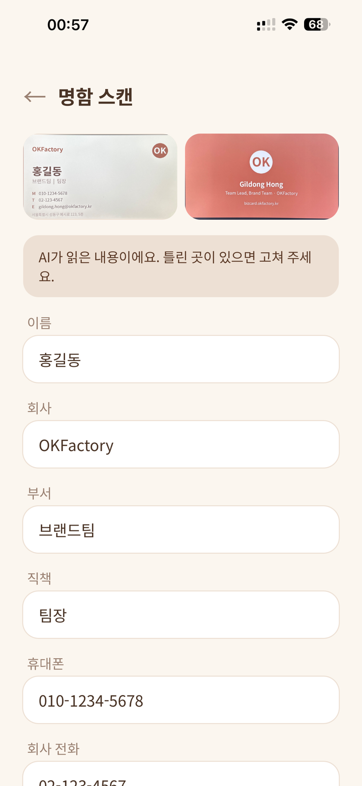
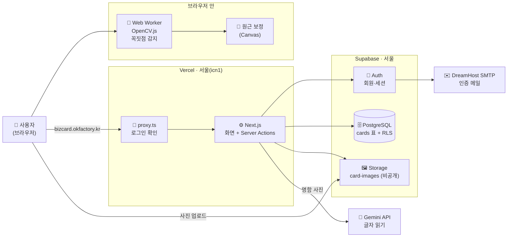
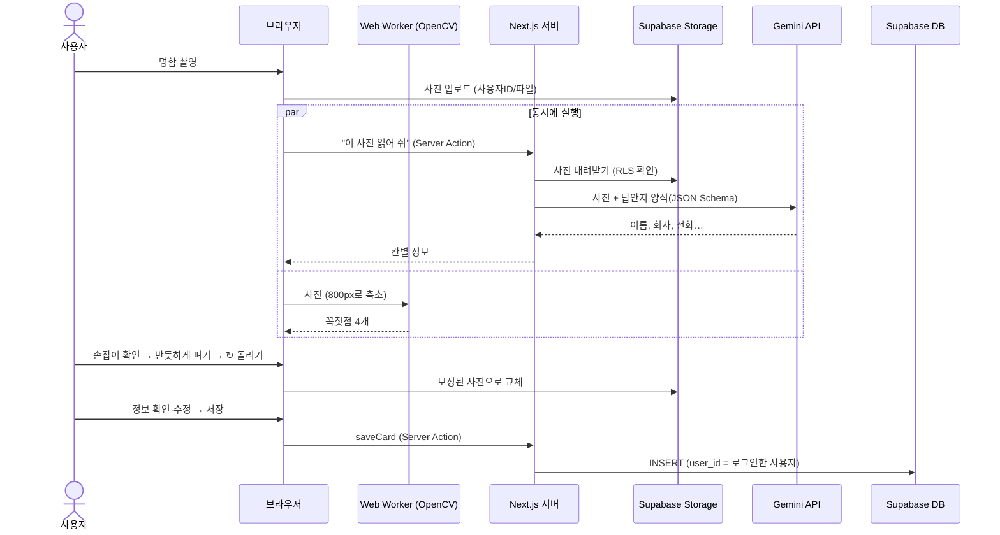

<div align="center">


# BizCard

**명함을 찍으면, 연락처가 됩니다.**

종이 명함을 휴대폰으로 찍으면 AI가 정보를 읽어 정리하고, 언제든 검색해서 버튼 하나로 휴대폰 연락처에 저장할 수 있는 웹앱입니다.

🔗 **https://bizcard.okfactory.kr**


</div>

---

## 목차

1. [만든 이유](#-만든-이유)
2. [주요 기능](#-주요-기능)
3. [화면](#-화면)
4. [기술 스택](#-기술-스택)
5. [시스템 구조](#-시스템-구조)
6. [데이터베이스 설계](#-데이터베이스-설계)
7. [보안](#-보안)
8. [문제 해결 기록](#-문제-해결-기록)
9. [폴더 구조](#-폴더-구조)
10. [직접 실행해 보기](#-직접-실행해-보기)
11. [앞으로 개선할 점](#-앞으로-개선할-점)
12. [배운 점](#-배운-점)

---

## 💡 만든 이유

명함을 명함첩에 보관하면 세 가지가 불편했습니다.

| 불편함 | BizCard의 해결 |
|---|---|
| 필요할 때 **찾기 어렵다** | 이름·회사·전화번호·메모로 **검색**, 태그로 **분류** |
| **가지고 다니기** 힘들다 | 휴대폰 웹앱으로 **어디서나** 열람 (홈 화면에 추가하면 앱처럼 사용) |
| 휴대폰 연락처에 **일일이 입력**하기 귀찮다 | AI가 **자동으로 읽고**, 버튼 하나로 **연락처에 저장** |

---

## ✨ 주요 기능

### 📸 명함 스캔과 자동 보정
- 휴대폰 카메라로 명함 앞면(필수)과 뒷면(선택)을 촬영
- **OpenCV**가 사진 속 명함의 네 꼭짓점을 찾고, **원근 보정**으로 비스듬히 찍은 명함을 반듯하게 펴기
- 흰 명함은 물론 **어두운 색 명함**도 감지 (사진 가운데에서 같은 색 영역을 넓혀 가는 방식)
- **방향 자동 판단**: AI가 글자의 방향을 알려 주면, 옆으로 눕거나 거꾸로 찍은 명함도 똑바로 세워서 펴기
- 꼭짓점이 틀리면 **손잡이를 끌어서** 직접 조정 (돋보기 지원), **↻ 돌리기**로 방향 맞추기

### 🤖 AI 정보 추출
- **Gemini API**가 이름, 회사, 부서, 직책, 휴대폰, 회사 전화, 팩스, 이메일, 주소, 홈페이지, LinkedIn을 칸별로 정리
- 저장 전 **확인·수정 화면**에서 AI가 틀린 부분을 고칠 수 있음

### 📇 명함 관리
- 명함 목록, 상세 보기, 수정, 삭제
- **검색**(이름·회사·부서·직책·이메일·전화·메모), **태그 필터**, **정렬**(최근 등록순·이름순·회사순)
- 상세 화면에서 📞 전화, 💬 문자, ✉️ 이메일, 📍 지도를 **한 번에** 실행

### 📲 휴대폰 연락처로 저장
- 명함을 **vCard(.vcf)** 파일로 만들어 아이폰·안드로이드 연락처 앱에 바로 저장
- 한글 이름은 성/이름으로 나누고, 휴대폰·회사 전화·팩스를 구분해서 저장

### 🔐 회원 기능
- **Google 로그인**, 이메일 회원가입과 **이메일 인증**, 로그인, 로그아웃, **비밀번호 찾기**
- 인증 메일은 자체 도메인(`noreply@okfactory.kr`)으로 발송
- 사용자마다 **자기 명함만** 볼 수 있음

### 📱 모바일 우선 디자인
- 휴대폰 화면을 먼저 생각한 반응형 디자인 (따뜻한 크림색 배경 + 커피 브라운)
- **PWA**: 홈 화면에 추가하면 주소창 없이 앱처럼 실행

---

## 🖼 화면

> 📌 화면 캡처에 나오는 명함은 모두 **테스트용 가상 명함**입니다. 실제 인물이나 연락처가 아닙니다.

| 로그인 | 명함 목록 | 명함 스캔 (앞·뒷면) |
|:---:|:---:|:---:|
|  |  |  |

| 꼭짓점 맞추기 | 원근 보정 결과 | AI가 읽은 정보 확인 |
|:---:|:---:|:---:|
|  |  |  |

---

## 🛠 기술 스택

| 분야 | 기술 | 선택한 이유 |
|---|---|---|
| 프론트엔드 + 백엔드 | **Next.js 16** (App Router), React 19, TypeScript | 화면과 서버 코드를 한 언어, 한 프로젝트로 개발. Server Actions로 별도 API 서버 없이 처리 |
| 디자인 | **Tailwind CSS 4** | 색상표(`globals.css`)를 한 곳에서 관리, 모바일 우선 반응형 |
| 데이터베이스·인증·파일 | **Supabase** (PostgreSQL, Auth, Storage) | 회원 관리와 비밀번호 보관을 직접 구현하지 않고 안전하게 처리. RLS로 행 단위 권한 관리 |
| 글자 인식 | **Google Gemini API** (`gemini-3.1-flash-lite`) | 명함을 읽고 정해진 JSON 양식(Structured Output)으로 칸별 정리까지 한 번에 |
| 명함 꼭짓점 감지 | **OpenCV.js** (Web Worker) | 브라우저 안에서 1초 이내, 무료, 사진이 외부로 나가지 않음 |
| 원근 보정 | 직접 구현 (호모그래피 + 쌍선형 보간) | 꼭짓점 4개로 사다리꼴을 직사각형으로 펴기 |
| 호스팅 | **Vercel** (서울 `icn1` 리전) | GitHub에 push하면 자동 배포. 데이터베이스와 같은 서울에 서버 배치 |
| 메일 | DreamHost SMTP | 자체 도메인 메일 발송, SPF·DKIM·DMARC 설정 |
| 도메인 | `bizcard.okfactory.kr` | CNAME으로 Vercel에 연결, HTTPS 자동 발급 |

---

## 🏗 시스템 구조



### 명함 한 장이 저장되기까지



---

## 🗄 데이터베이스 설계

### `cards` 표

| 칸 | 형식 | 설명 |
|---|---|---|
| `id` | uuid (PK) | 명함 고유 번호 |
| `user_id` | uuid (FK → `auth.users`) | 주인. 기본값 `auth.uid()`, 회원 탈퇴 시 함께 삭제 |
| `name`, `company`, `department`, `title` | text | 이름, 회사, 부서, 직책 |
| `mobile`, `phone`, `fax`, `email` | text | 연락처 |
| `address`, `website`, `linkedin` | text | 주소, 홈페이지, LinkedIn |
| `memo` | text | 메모 |
| `tags` | text[] | 그룹·태그 (여러 개, GIN 색인) |
| `image_path`, `image_back_path` | text | Storage의 앞면·뒷면 사진 위치 |
| `created_at`, `updated_at` | timestamptz | 등록·수정 시각 (수정 시 트리거로 자동 갱신) |

- 태그는 별도 표 대신 **배열 칸 하나**로 설계해서 구조를 단순하게 유지했습니다.
- 사진은 표에 직접 넣지 않고 **Storage에 보관**하고, 표에는 위치만 기록합니다.
- 모든 설계는 [`supabase/migrations/`](supabase/migrations) 의 SQL 파일로 기록되어 있어, 같은 환경을 다시 만들 수 있습니다.

---

## 🔒 보안

| 위협 | 대응 |
|---|---|
| 다른 사람의 명함 보기·수정·삭제 | **RLS(Row Level Security)** 정책 4개: `auth.uid() = user_id`인 행만 조회·추가·수정·삭제 |
| 다른 사람의 명함 사진 보기 | Storage를 **비공개 버킷**으로 만들고, `사용자ID/파일` 폴더 구조 + 폴더 이름이 내 ID인 파일만 허용하는 정책. 사진은 **1시간짜리 임시 링크**로만 표시 |
| 서버 코드의 실수 | 서버에서 한 번(경로·로그인 확인), DB/Storage에서 한 번(RLS) **이중 확인** |
| 비밀 키 유출 | Gemini 키는 `NEXT_PUBLIC_` 없이 **서버에서만** 사용. 모든 키는 `.env.local`과 Vercel 환경 변수에 보관하고 Git에 올리지 않음 |
| 로그인하지 않은 접근 | `proxy.ts`가 모든 요청 전에 세션을 확인하고 `/cards`는 로그인 화면으로 이동 |
| 가입 여부 캐내기 | 비밀번호 찾기에서 가입 여부와 관계없이 **같은 안내 문구** 표시 |
| AI 요금 남용 | 한 사용자가 1시간에 사진 60장 이상 읽기를 요청하면 차단 |
| 악성 링크 | 홈페이지·LinkedIn 링크는 `https://`를 붙여 `javascript:` 같은 스크립트가 실행되지 않게 처리 |

---

## 🔧 문제 해결 기록

### 1. 명함 자동 보정: AI에게 꼭짓점을 물어보면 안 되는 이유

명함을 비스듬히 찍으면 사다리꼴로 찍히기 때문에, 꼭짓점 4개를 찾아 **원근 보정**으로 펴는 기능을 만들었습니다. 펴는 계산(호모그래피)은 정확했지만, **꼭짓점을 누가 찾느냐**에서 여러 번 실패했습니다.

| 시도 | 결과 | 원인 |
|---|---|---|
| ① Gemini Flash-Lite에게 "꼭짓점 4개를 알려 줘" | ❌ 오히려 더 비뚤어짐 | 로그를 분석해 보니, 기울어진 명함의 진짜 꼭짓점 대신 **똑바른 네모 상자의 끝 값**을 섞어서 답함. 순서도 꼬여서 8자로 비틀림 |
| ② Gemini Flash에게 **분할(segmentation) 윤곽선**을 받아 꼭짓점은 직접 계산 | 🔺 정확해졌지만 **98초** | Flash 모델이 답하기 전에 오래 "생각"함. 무료 등급의 사용량 제한도 영향 |
| ③ 생각을 최소로 줄이기 | ❌ 정확도 하락, 여전히 114초 | 정확도와 속도를 함께 얻을 수 없었음 |
| ④ **OpenCV**로 브라우저에서 직접 찾기 | ✅ **1초 이내, 오차 대폭 감소** | AI는 글자 읽기만, 위치 찾기는 컴퓨터 비전에 맡김 |

**OpenCV 방법**: 명함 종이는 "밝고 색이 옅다"는 점을 이용해 HSV 색 공간에서 명함 영역을 찾고(밝기 기준은 Otsu 방법으로 자동 결정), 명함에 붙은 하얀 물체(슬리퍼 테두리 등)를 **모폴로지 열기**로 끊어 냅니다. 끊는 세기를 5단계로 시도한 뒤, *사각형에 얼마나 꼭 맞는지*와 *명함 비율(1.3~2.3)인지*로 점수를 매겨 가장 명함다운 영역을 고르고, **볼록 껍질 → 가장 넓은 사각형**으로 꼭짓점을 계산합니다.

**실제 사진 두 장으로 비교한 꼭짓점 오차** (사진 크기를 1000으로 본 좌표 기준)

| 방법 | 사진 A | 사진 B | 시간 |
|---|---|---|---|
| Gemini Flash-Lite가 직접 답한 꼭짓점 | 최대 200 이상 | 순서 꼬임 | 약 8초 |
| Gemini Flash 윤곽선 + 직접 계산 | 9~44 | — | 98초 |
| **OpenCV** | **5~32** | **4~11** | **1초 이내** |

**화면이 멈춘 문제**: OpenCV.js(10MB)를 화면을 그리는 메인 스레드에서 불러오자 브라우저가 응답하지 않았습니다. **Web Worker**로 분리해서 화면과 따로 실행하고, 파일을 외부 CDN 대신 프로젝트 안(`public/opencv/`)에 두었습니다. 20초 안에 끝나지 않으면 워커를 종료하고 기본 위치로 손잡이를 보여 줍니다.

**마지막 안전장치**: 어떤 자동 감지도 틀릴 수 있으므로, 사용자가 **손잡이로 확인·수정**한 사진만 저장합니다.

> 💬 교훈: 각 도구를 **잘하는 일**에 쓰자. AI는 글자를 이해하고, 컴퓨터 비전은 정밀한 위치를 찾고, 사람은 최종 확인을 한다.

### 1-1. 어두운 명함 감지와 방향 자동 판단

- **어두운 명함**: 처음에는 "흰 종이"만 찾았기 때문에 남색·검정 명함을 놓쳤습니다. "어두운 부분"도 찾게 해 봤지만, 청바지 같은 어두운 배경과 명함이 한 덩어리로 붙어 버렸습니다.
  그래서 방법을 바꿔, **사진 가운데 9곳에서 출발해 비슷한 색(Lab 색공간)으로 이어진 영역을 넓혀 가는 방식(flood fill)**을 더했습니다. 명함은 보통 사진 가운데에 있기 때문입니다. 흰 종이 방식과 함께 후보를 만들고, 명함 비율(약 1.3~2.3)과 네모 모양에 가까운 정도로 점수를 매겨 가장 좋은 것을 고릅니다.
- **방향 자동 판단**: OpenCV는 네모는 찾지만 어느 변이 "위"인지는 모릅니다. 그래서 글자를 읽는 Gemini에게 **"몇 도 돌려야 글자가 서는지"**도 함께 묻고, 그 방향과 가장 가까운 변을 윗변으로 삼아 펴도록 했습니다. 0°·30°·90°·135°·180°·270°·315° 회전 × 시작 꼭짓점 4가지, 모두 32개 경우를 시험해 통과했습니다.
- **알려진 한계**: 명함 가장자리에 다른 색 띠가 있는 디자인은 띠 부분이 잘릴 수 있어서, 손잡이로 직접 맞춰야 합니다.

### 2. 사이트가 느렸던 이유: 서버와 DB가 태평양 건너에 있었다

- **원인 ①**: Vercel 함수의 기본 지역은 미국 워싱턴 D.C.(`iad1`)인데, Supabase는 서울에 있었습니다. 화면 하나를 열 때 DB와 3~4번 태평양을 왕복했습니다.
  **해결**: `vercel.json`에 `"regions": ["icn1"]`을 넣어 서버를 서울로 옮겼습니다.
- **원인 ②**: 화면을 열 때마다 `getUser()`로 Supabase 인증 서버에 로그인 여부를 물어봤습니다(proxy와 화면에서 각각).
  **해결**: JWT 서명을 그 자리에서 검증하는 `getClaims()`로 바꿔 네트워크 왕복을 줄였습니다. 데이터 보호는 RLS가 계속 담당합니다.

### 3. 인증 메일이 스팸함으로 간 이유

- Gmail의 "원본 보기"로 확인하니 SPF·DKIM은 통과했지만 **DMARC 레코드가 없었고**, 메일 중계 서버가 `X-MC-Relay: Junk`로 분류하고 있었습니다.
- **해결**: DNS에 `_dmarc` TXT 레코드(`v=DMARC1; p=none;`)를 추가하고, Supabase 기본 영어 템플릿을 **한국어 템플릿**으로 바꾸면서 링크를 `supabase.co`가 아닌 **자체 도메인**(`/auth/confirm?token_hash=…`)으로 변경했습니다. 덤으로, 다른 기기에서 메일 링크를 눌러도 인증되도록 개선됐습니다.

### 4. 좁은 화면에서 오른쪽이 잘리는 문제

- 검색창 입력칸의 기본 폭과 한 줄에 억지로 넣은 정렬 버튼이 좁은 화면(약 310px)에서 화면을 밀어냈습니다.
- **해결**: 입력칸이 줄어들 수 있게 하고(`size={1}`, `min-w-0`), 정렬 줄은 공간이 부족하면 두 줄로 내려가게(`flex-wrap`), 긴 태그는 말줄임표로 처리했습니다.

### 5. 새로 스캔하려는데 이전 스캔 화면이 남아 있던 문제

- **원인**: Next.js 16(Cache Components)은 다른 화면으로 이동해도 이전 화면을 지우지 않고 React의 `<Activity>`로 **숨겨 둡니다**. 뒤로 가기 때 쓰던 내용을 되살리기 위한 기능이지만, 매번 새로 시작해야 하는 스캔 흐름에는 맞지 않았습니다.
- **해결**: 스캔 화면이 숨겨지는 순간(`useLayoutEffect` 정리 함수) React `key`를 바꿔 처음 상태로 다시 만들도록 했습니다. 이때 **저장하지 않고 떠난 스캔의 사진을 Storage에서 삭제**하도록 해서, 버려진 사진이 쌓이는 문제도 함께 해결했습니다.

---

## 📁 폴더 구조

```
bizcard/
├── public/
│   ├── opencv/opencv.js        # OpenCV.js (10MB, 직접 보관)
│   ├── opencv-worker.js        # Web Worker: 명함 꼭짓점 감지
│   └── icon-*.png              # 홈 화면 아이콘
├── src/
│   ├── app/
│   │   ├── page.tsx            # 첫 화면
│   │   ├── login/ signup/      # 로그인, 회원가입
│   │   ├── forgot-password/ reset-password/   # 비밀번호 찾기
│   │   ├── auth/confirm/route.ts  # 인증 메일 링크 처리
│   │   ├── auth-actions.ts     # 회원 관련 Server Actions
│   │   ├── cards/
│   │   │   ├── page.tsx        # 명함 목록 (검색·태그·정렬)
│   │   │   ├── new/page.tsx    # 명함 스캔
│   │   │   ├── [id]/page.tsx   # 명함 상세
│   │   │   ├── [id]/edit/      # 명함 수정
│   │   │   ├── [id]/vcard/route.ts  # 연락처 파일(.vcf) 만들기
│   │   │   └── actions.ts      # 명함 읽기·저장·삭제 Server Actions
│   │   ├── manifest.ts         # PWA 설정
│   │   └── globals.css         # 디자인 색상표
│   ├── components/
│   │   ├── ScanCard.tsx        # 스캔 흐름 (촬영 → 읽기 → 보정 → 확인)
│   │   ├── CornerAdjuster.tsx  # 꼭짓점 손잡이 + 돋보기
│   │   ├── CardForm.tsx        # 명함 정보 입력 양식
│   │   └── ...
│   ├── lib/
│   │   ├── gemini.ts           # Gemini 글자 읽기 (서버 전용)
│   │   ├── opencv.ts           # Web Worker 연락 담당
│   │   ├── perspective.ts      # 원근 보정 (호모그래피), 회전
│   │   ├── vcard.ts            # vCard 만들기
│   │   └── supabase/           # Supabase 연결 (브라우저·서버·proxy)
│   └── proxy.ts                # 요청마다 로그인 확인
├── supabase/migrations/        # DB·Storage 설계 SQL
└── vercel.json                 # 서버 지역: 서울(icn1)
```

---

## 🚀 직접 실행해 보기

**필요한 것**: Node.js 20 이상, Supabase 프로젝트, Gemini API 키

```bash
git clone https://github.com/ms1968-park/bizcard.git
cd bizcard
npm install
```

1. Supabase 대시보드의 **SQL Editor**에서 [`supabase/migrations/`](supabase/migrations)의 SQL 파일 두 개를 순서대로 실행합니다.
2. `.env.example`을 복사해 `.env.local`을 만들고 값을 채웁니다.

```bash
NEXT_PUBLIC_SUPABASE_URL=https://xxxx.supabase.co
NEXT_PUBLIC_SUPABASE_PUBLISHABLE_KEY=sb_publishable_xxxx
GEMINI_API_KEY=xxxx            # 서버 전용, NEXT_PUBLIC_ 붙이지 않기
```

3. (선택) 테스트용 가상 명함 [`docs/sample-cards/print_A4.pdf`](docs/sample-cards/print_A4.pdf)를 A4 용지에 실제 크기로 인쇄하면, 실제 명함처럼 촬영해서 시험할 수 있습니다.
4. 실행합니다.

```bash
npm run dev
# → http://localhost:3000
```

---

## 🌱 앞으로 개선할 점

- [x] ~~**버려진 사진 정리**: 스캔 후 저장하지 않고 나가면 업로드한 사진이 남음~~ → 스캔 화면을 떠날 때 저장하지 않은 사진을 삭제하도록 해결
- [ ] 브라우저를 그냥 닫는 경우까지 대비해, 일정 시간 지난 고아 파일을 지우는 정기 작업
- [ ] **꼭짓점 감지 강화**: 흰 명함을 흰 책상 위에 놓은 경우처럼 배경과 대비가 약할 때는 테두리선(Canny) 기반 감지를 함께 사용
- [ ] **방향 자동 판단**: 펴진 명함이 옆으로 누워 있을 때 글자 방향을 보고 자동으로 돌리기
- [ ] **엑셀로 내보내기**, **구글 로그인**, **명함 공유**
- [ ] PC 웹캠으로 바로 촬영

---

## 📝 배운 점

> ✏️ *이 부분은 직접 경험을 바탕으로 자신의 말로 다듬어 주세요.*

- **웹의 기본 구조**: 프론트엔드(홀) · 백엔드(주방) · 데이터베이스(창고) · API(주문서)가 어떻게 연결되는지, 그리고 `git push`부터 Vercel 빌드·배포, DNS로 도메인이 연결되는 과정까지 처음부터 끝까지 경험했습니다.
- **보안은 한 겹으로 부족하다**: 서버 코드에서 확인하고, 데이터베이스(RLS)에서도 한 번 더 막는 이중 구조의 중요성을 배웠습니다.
- **AI는 만능이 아니다**: 같은 AI라도 잘하는 일(글자 이해)과 못하는 일(정밀한 위치)이 있었습니다. 로그를 남기고 실제 좌표를 비교하는 **데이터 기반 디버깅**으로 원인을 찾고, 컴퓨터 비전과 역할을 나눠 해결했습니다.
- **속도는 거리와 왕복 횟수**: 서버와 DB의 물리적 위치, 네트워크 요청 횟수가 체감 속도를 좌우한다는 것을 직접 측정하며 배웠습니다.
